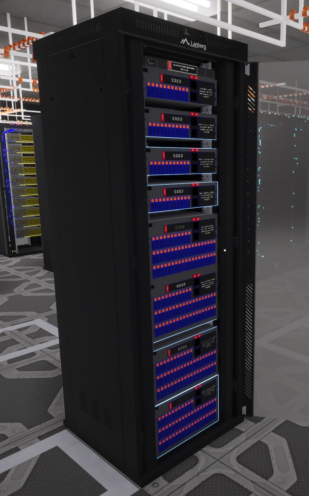
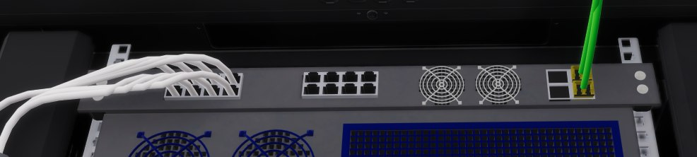

# Next-Gen Hardware

A mod for **Data Center** (by Waseku) that adds better servers to the shop: **Gen 2, Gen 3 and Gen 4** versions of every server in the game. It also adds a switch with both copper and fibre ports.

Late in the game, a big customer means filling rack after rack with the same 3U servers and cabling every one. Next-Gen servers do that job in less space with fewer cables. They cost more money and XP, so the normal servers are still worth buying early on.



**Contents:** [What it adds](#what-it-adds) · [Before you install](#before-you-install) · [Install](#install) · [Check it worked](#check-it-worked) · [How to use the new servers](#how-to-use-the-new-servers) · [Updating](#updating) · [Uninstalling](#uninstalling) · [Saves](#saves) · [Co-op](#co-op) · [Problems](#problems) · [Building from source](#building-from-source)

---

## What it adds

### 24 new servers

Every normal server (System X, RISC, GPU and Mainframe, in 3U and 7U sizes) gets a Gen 2, Gen 3 and Gen 4 version. They look like the normal ones, plus lights on the front.

| | 3U server | 7U server | Network ports | Front lights |
|---|---:|---:|---|---|
| Normal (Gen 1) | 5,000 IOPS | 12,000 IOPS | 2 copper, 1 Gbps | none |
| **Gen 2** | 9,000 IOPS | 25,000 IOPS | 2 copper, 10 Gbps | one bar along the bottom |
| **Gen 3** | 15,000 IOPS | 42,000 IOPS | 2 SFP slots | bars along the top and bottom |
| **Gen 4** | 24,000 IOPS | 67,000 IOPS | 2 SFP slots | a full frame with a moving light |

- **Faster ports.** A normal server's ports run at 1 Gbps, which limits any server to 20,000 IOPS no matter how many cables you plug in. Gen 2 ports run at 10 Gbps. Gen 3 and Gen 4 have SFP slots instead of copper ports (see [How to use the new servers](#how-to-use-the-new-servers)).
- **7U or 3U?** Six 7U servers fill 42 rack units and beat sixteen 3U servers (48 units), but they cost more.
- **Lights** use the server's family colour. They go dark when a server is switched off or broken.

### Prices and unlocking

You unlock each server with XP, like the normal ones. They unlock **in order**: a Gen 2 needs the normal version of that server unlocked first, a Gen 3 needs the Gen 2, and a Gen 4 needs the Gen 3. If you try to skip one, a message tells you what to unlock first.

| Server | Gen 2 | Gen 3 | Gen 4 |
|---|---|---|---|
| System X 3U | $790 · 3,080 XP | $1,450 · 6,040 XP | $2,560 · 11,830 XP |
| System X 7U | $3,670 · 4,310 XP | $6,780 · 8,450 XP | $11,890 · 16,560 XP |
| RISC 3U | $890 · 4,200 XP | $1,630 · 8,230 XP | $2,870 · 16,130 XP |
| RISC 7U | $4,010 · 5,880 XP | $7,410 · 11,520 XP | $13,000 · 22,590 XP |
| GPU 3U | $1,090 · 7,700 XP | $2,000 · 15,090 XP | $3,510 · 29,580 XP |
| GPU 7U | $5,040 · 10,780 XP | $9,320 · 21,130 XP | $16,350 · 41,410 XP |
| Mainframe 3U | $1,680 · 9,100 XP | $3,090 · 17,840 XP | $5,430 · 34,960 XP |
| Mainframe 7U | $5,610 · 12,740 XP | $10,370 · 24,970 XP | $18,190 · 48,940 XP |

Within each family the XP cost climbs steadily (each step costs 1.4× the one before): normal 3U → normal 7U → Gen 2 3U → Gen 2 7U → Gen 3 3U → … → Gen 4 7U.

### A new switch: 16 copper ports + 4 SFP slots

The starter switch (16 × 10 Gbps copper ports) with 4 SFP slots added on the right. It fills the gap between the starter switch and the all-fibre switches. It costs **$810** and **500 XP**, and you need the "4 x SFP" switch unlocked first.



### A fix for a bug where new servers stop connecting

Some other mods (AutoLACP 1.0.0, for example) can knock the game's message ticker out of sync. When that happens, newly placed servers and switches stop connecting to customers until you restart the game. This mod quietly repairs the ticker before that can happen, whichever mod caused it.

---

## Before you install

You need these once, for any code mod in Data Center. If you already use other code mods (for example from the Steam Workshop), you most likely have them already. Skip to [Install](#install).

1. **MelonLoader 0.7.3** (the mod loader).
   - Download the installer from the [MelonLoader releases page](https://github.com/LavaGang/MelonLoader/releases) and run it.
   - Point it at `Data Center.exe`. To find that file: in your Steam Library, right-click **Data Center** → **Manage** → **Browse local files**.
   - Choose version **0.7.3** and install.
   - Start the game once (the first start with MelonLoader takes a while), then quit.
2. **A fix-up plugin for the game's generated files.** Data Center's files trip up MelonLoader, and without a fix **no code mods load at all**. Install one of these and follow its own instructions:
   - [DS-InteropFix](https://steamcommunity.com/sharedfiles/filedetails/?id=3797166996) (Steam Workshop), or
   - [Il2CppAssemblyFixer](https://github.com/mleem97/Il2CppAssemblyFixer) (GitHub).

---

## Install

There's only one file to install: **`NextGenHardware.dll`**. MelonLoader only loads code mods from the **`Mods`** folder inside your Data Center game folder, so that's where the file needs to end up. Pick whichever of these fits you.

### Easiest: Steam Workshop with WorkshopModSync

If you have the **WorkshopModSync** helper, Workshop mods install themselves:

1. Click **Subscribe** on the [Workshop page](https://steamcommunity.com/sharedfiles/filedetails/?id=3829635443).
2. Start the game.

That's it. Every time the game starts, WorkshopModSync copies your subscribed Workshop mods into the right folders, updates included.

**Do I have it?** Open your game folder (in your Steam Library, right-click **Data Center** → **Manage** → **Browse local files**) and look in its **`Plugins`** folder. If `WorkshopModSync.dll` is there, you have it.

**Don't have it yet?** [WorkshopModSync](https://steamcommunity.com/sharedfiles/filedetails/?id=3830456292) is a free helper made by Bloody, on the Steam Workshop. It can't install itself, so set it up once:
1. Close the game and subscribe to [WorkshopModSync](https://steamcommunity.com/sharedfiles/filedetails/?id=3830456292).
2. Follow **Set it up once** on its page. It comes with a one-click installer (`WorkshopModSyncInstaller.exe`) that finds Data Center and puts the helper in the right place.

From then on, every Workshop code mod you subscribe to (this one included) installs itself when you start the game.

### Steam Workshop without WorkshopModSync: copy one file

Data Center downloads Workshop mods into a folder of its own, which MelonLoader doesn't look in. So you copy the file across once:

1. Click **Subscribe** on the [Workshop page](https://steamcommunity.com/sharedfiles/filedetails/?id=3829635443).
2. Start Data Center, wait for the main menu, then quit. This lets the game copy the download into its own folder.
3. Open your game folder: in your Steam Library, right-click **Data Center** → **Manage** → **Browse local files**.
4. Open these folders in turn: **`Data Center_Data`** → **`StreamingAssets`** → **`Mods`**.
5. Find the Next-Gen Hardware folder. It's called `workshop_` followed by a long number. The easy way: type `NextGenHardware` into the search box at the top right of the File Explorer window.
6. Inside it, open the **`Mods`** folder and copy **`NextGenHardware.dll`** (right-click → Copy).
7. Go back to the game folder from step 3 (the one with `Data Center.exe` in it), open its **`Mods`** folder, and paste.
8. Start the game.

### From GitHub (without the Workshop)

1. Download `NextGenHardware.dll` from the [Releases page](https://github.com/checkersx/data-centre-next-gen-hardware/releases).
2. Put it in the `Mods` folder inside your game folder. To find the game folder: in your Steam Library, right-click **Data Center** → **Manage** → **Browse local files**.
3. Start the game.

### Upgrading from "New Servers"

This mod used to be called **New Servers**. If you had it, **delete `NewServers.dll` from your `Mods` folder**, or both versions load and clash. Your unlocks and upgraded servers carry over.

---

## Check it worked

- **In the MelonLoader console** (the black text window that opens with the game), look for **`Next-Gen Hardware v1.0.0`**.
- **In the game**, open the shop on the computer. Each server row now has extra cards such as **"System X 3U Gen 2 9000 IOPS"**, with Gen 3 and Gen 4 in a new row underneath.

If neither shows up, see [Problems](#problems).

---

## How to use the new servers

**Gen 2** works exactly like a normal server: rack it, cable it, done.

**Gen 3 and Gen 4 have SFP slots instead of copper ports.** A slot needs a small plug-in module before a cable will connect, the same as on the game's fibre switches:

1. Buy a box of SFP modules from the shop.
2. Hold the box, look at the server's empty slot, and click to insert a module.
3. Plug a cable into the module.

Any module type works and is fast enough for one server. The **SFP RJ45** module takes an ordinary copper cable, so you don't need fibre unless you want it.

---

## Updating

- **Workshop with WorkshopModSync:** nothing to do. Steam downloads the update, and WorkshopModSync installs it the next time you start the game.
- **Workshop without WorkshopModSync:** Steam downloads the update. With the game closed, copy the new `NextGenHardware.dll` across again, as in steps 2–7 of [Steam Workshop without WorkshopModSync](#steam-workshop-without-workshopmodsync-copy-one-file).
- **GitHub:** download the new DLL and replace the old one, with the game closed.

---

## Uninstalling

1. Close the game.
2. If you subscribed on the Workshop, unsubscribe first. Otherwise WorkshopModSync copies the file straight back.
3. Delete `NextGenHardware.dll` from your game's `Mods` folder.

Your saves still load afterwards (see [Saves](#saves)).

---

## Saves

**Your save files stay "vanilla"** (readable by the unmodded game). When the game saves, each upgraded server and new switch is written as its normal version. A small extra file next to the save (`<save name>.newservers.json`) remembers which ones were really upgrades. When you load with the mod installed, they come back.

**If you remove the mod**, your saves still load. You'll find:
- Upgraded servers have turned back into their normal versions (normal IOPS).
- The new switch is a plain starter switch, and any cables that were in its 4 SFP slots are gone.
- Gen 3/4 servers lose the modules and cables in their SFP slots. Re-cable those servers to get them working again.

**Other things to know:**
- **Steam Cloud** might not copy the small `.newservers.json` file to another PC. If it doesn't, upgraded servers load as normal ones on that PC. (Not tested.)
- **Rack templates** (in the designer room) don't support upgraded hardware yet. Don't save a template with upgraded servers or the new switch in it.

---

## Co-op

**Co-op has never been tested.** In theory it should work, as long as **every player has the mod installed, at the same version**. If only one player has it, you'll see different hardware from each other, so expect problems.

---

## Problems

**No mods load at all, or the log says "No Support Module Loaded".**
- Right after a game update, this is normal: quit and start the game a second time.
- Otherwise, check you have one of the fix-up plugins from [Before you install](#before-you-install).

**The mod doesn't show up in the MelonLoader console.**
Check the file is in the right place: `Data Center\Mods\NextGenHardware.dll`. The `Mods` folder is the one next to `Data Center.exe`, not the one inside `StreamingAssets`.

**The log says "Next-Gen Hardware is not registering".**
Another mod has changed the game's list of servers. Try without other server mods to find which one.

**Something else.**
Open an issue on [GitHub](https://github.com/checkersx/data-centre-next-gen-hardware/issues). Please include the file `Data Center\MelonLoader\Latest.log`, which holds everything the mods wrote while the game was running.

---

## Compatibility

- Standalone: no gregCore or other framework needed.
- Mods that add their own server types to the game's server list will clash with this one.
- Tested on Steam build 25869593 of Data Center, with MelonLoader 0.7.3.
- Not affiliated with Waseku.

## Building from source

You need the .NET SDK (6 or later) and the game with MelonLoader installed (start the game once so MelonLoader generates its files).

```
dotnet build -c Release src/NextGenHardware
```

The build looks for the game at `G:\SteamLibrary\steamapps\common\Data Center`. If yours is somewhere else, add `-p:GameDir="<your game folder>"`. The built DLL is copied straight into the game's `Mods` folder (add `-p:Deploy=false` to skip that). Close the game first, because the game locks the DLL while it's running.

`src/NewServers.Probe` is a read-only diagnostic used during development. You don't need it.

## Licence

[GNU General Public License v3.0](LICENSE).
